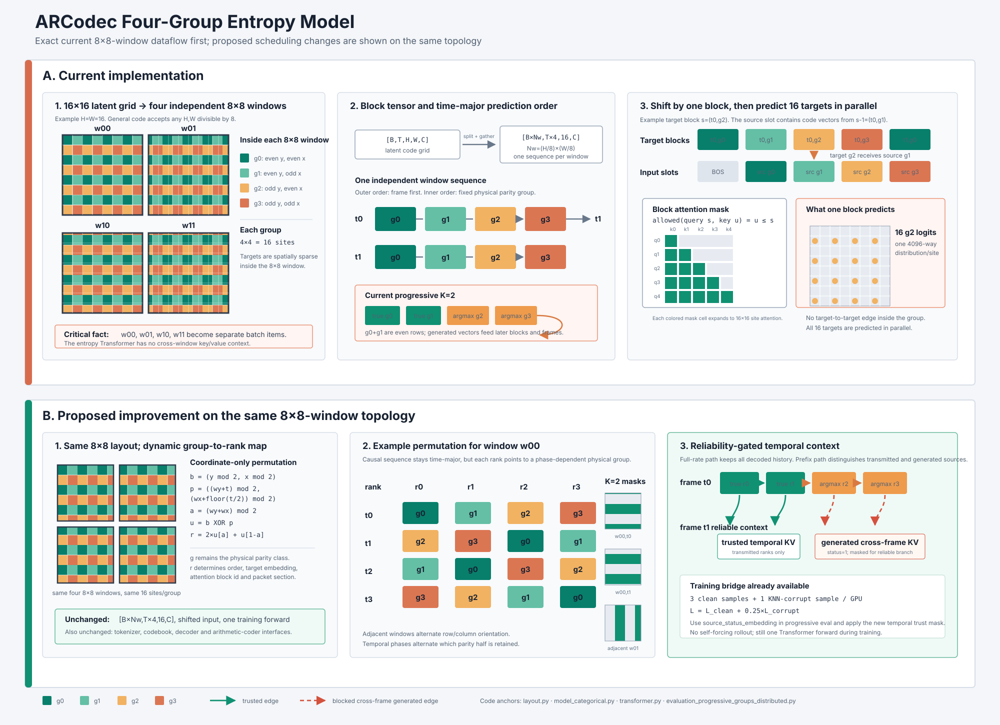

# Entropy Model Improvement Directions



图 1：上半部分展示当前固定 parity rank 与 time-major rollout 如何产生方向性
K=2 前缀，并让生成错误进入后续帧；下半部分展示 temporal phase rotation 如何在
不改变 tokenizer 的情况下平衡前缀，以及 prefix completion 如何只保留可靠的已传输
groups 作为 temporal context。完整码率路径仍使用全部已解码历史。

本文记录 ARCodec entropy model 后续仅考虑的两个改进方向：

1. 改进 8×8 window attention mask 和 group prediction order。
2. 缩小 teacher-forcing 训练与 self-forcing 推理之间的 context gap。

研究范围严格限定为 entropy model。Stage1/Stage3 tokenizer、codebook、encoder 和
decoder 均保持不变。

当前 Stage2 训练细节见 `docs/stage2.md`。主要实现位于：

- `entropy_model/layout.py`
- `entropy_model/transformer.py`
- `entropy_model/model_categorical.py`
- `scripts/stage2.py`
- `training/evaluation_progressive_groups_distributed.py`

## 1. Requirements

改进必须同时满足：

- 完整编码时不破坏、最好提升 entropy model 的概率建模能力。
- group 截断时，K=1/2/3 的重建质量下降更小。
- attention mask 和 prediction order 必须对应一个合法的解码拓扑，不能使用尚未
  从 bitstream 解码的 target index。
- encoder 和 decoder 必须使用完全一致且确定性的 group order、context 和生成规则。
- benchmark 输出继续使用结构化的 `bpp`、`psnr` 和 `latency_ms`，并附加
  LPIPS-VGG、LPIPS-Alex 和 DISTS。

## 2. Current Entropy Model

每个 latent frame 的 16×16 index grid 被划分为四个 8×8 windows。每个 window
根据坐标奇偶性分为四组：

```text
g0: even y, even x
g1: even y, odd x
g2: odd y,  even x
g3: odd y,  odd x
```

每个 group 包含 16 个 index。当前 block 顺序为 time-major：

```text
(t0,g0) → (t0,g1) → (t0,g2) → (t0,g3)
→ (t1,g0) → ... → (t_last,g3)
```

当前 attention mask 只比较 block id：

```text
allowed(query, key) = block_id(query) ≥ block_id(key)
```

输入整体右移一个 block，因此当前 block 的 input 是上一 group 的 code vectors，而
不是当前 target indices。当前 block 的 16 个 query 可以共同读取这 16 个 shifted
inputs，但 16 个 target index 仍然条件独立预测。

### 2.1 Current limitations

1. 不同 8×8 windows 被折叠进 batch，window 之间没有 entropy context。
2. 同一 group 的 16 个 target 之间没有 target dependency。
3. 固定 time-major order 让每帧的 generated missing groups 立即进入下一帧 context，
   progressive decoding 中的错误会持续传播。
4. 当前 K=2 保留 `g0+g1`，它们覆盖完整偶数行，空间采样具有明显方向性；
   `g0+g3` 则形成均匀 checkerboard。
5. Stage2 只在真实 previous-group context 上训练，而 progressive eval 将模型生成的
   index 重新送回 entropy model。

## 3. Direction 1: Partial-Order Context and Group Ordering

该方向同时修改 prediction order 和 attention dependency graph，目标是增强 entropy
context，并使每一个 progressive prefix 都保留更均匀、更完整的观测。

### 3.1 Prefix-balanced group order

第一版固定 group order：

```text
g0 → g3 → g1 → g2
```

这样 K=2 时保留 `g0+g3`，形成完整 checkerboard，而不是当前的水平条纹。K=1
仍保留均匀的 2×2 subsampling；K=3 只缺失一个 parity group。

固定顺序本身不能保证 BPP 更低，需要重新训练 entropy model，并分别比较四个 group
的 conditional bits、top-1 accuracy 和 progressive reconstruction metrics。

### 3.2 GOP-group-major prediction

将连续 G 个 latent frames 组成一个 GOP。初始实验使用 G=4：

```text
layer 0: (t0,g0) → (t1,g0) → (t2,g0) → (t3,g0)
layer 1: (t0,g3) → (t1,g3) → (t2,g3) → (t3,g3)
layer 2: (t0,g1) → (t1,g1) → (t2,g1) → (t3,g1)
layer 3: (t0,g2) → (t1,g2) → (t2,g2) → (t3,g2)
```

K-group progressive bitstream 先提供 GOP 内全部 K 个 retained layers，再预测其余
layers。与当前 time-major order 相比，missing-group completion 可以先获得完整的
temporal base context，不需要在每个 frame 内立即生成缺失 group 后再进入下一帧。

该设计增加 G 个 latent frames 的 buffering latency，因此 G 必须同时报告：

- full-rate estimated BPP
- K=1/2/3 reconstruction metrics
- encode/decode latency
- first-frame latency

### 3.3 Partial-order attention mask

将每个 prediction node 定义为：

```text
node = (GOP, group_layer, time, window, site)
```

合法 dependency 为：

1. GOP 内所有更早 group layers。
2. 当前 group layer 内更早的 time positions。
3. 更早 GOP 中允许保留的 causal history。
4. 相邻 windows 中已经解码的 group layers。

禁止 dependency 为：

1. 当前尚未解码的 target index。
2. 同一 coding step 中其他 window 的 target index。
3. 当前 group 内其他 site 的 target，除非额外引入明确的 intra-group substeps。

### 3.4 Overlapping context, non-overlapping targets

8×8 继续作为 non-overlapping query/target tile，但 key/value context 增加相邻 window
的已解码 halo：

```text
target region:  8×8
context region: 12×12 或 16×16
```

只输出中心 8×8 target 的 logits。halo 中只能出现依赖图允许的 decoded groups。
该设计打破 window 独立性，但不增加 arithmetic coding 的 group step 数。

优先比较：

| context | serial group steps | expected effect |
| --- | ---: | --- |
| current independent 8×8 | 4 / frame | baseline |
| 8×8 target + 12×12 halo | unchanged | lower BPP, better boundary context |
| 8×8 target + 16×16 halo | unchanged | larger context, higher memory cost |

不能假设 context 越大越好。Checkerboard Context Model 的分析表明近邻通常贡献最多
mutual information，过远 context 可能只增加容量和过拟合风险。

### 3.5 Random-order pretraining and fixed-order annealing

参考 Randomized Autoregressive Visual Generation，训练早期从四个 groups 的 24 种
合法 permutation 中采样顺序，然后逐步退火到固定的 `g0→g3→g1→g2`：

```text
r(step) = random-order batch probability

early training: r = 1
annealing:      r decreases from 1 to 0
final training: r = 0
```

每个 input 必须加入 target-group-aware embedding，显式说明当前 logits 对应哪个
target group。每个随机顺序仍使用严格 causal mask，因此它仍然定义合法的
autoregressive factorization。

该阶段的目的不是在 bitstream 中使用随机 order，而是让参数在训练早期学习不同方向
的 spatial dependency，最终仍收敛到一个固定且可复现的编码顺序。

### 3.6 Direction 1 experiment order

按以下顺序独立验证，避免同时修改多个变量：

1. 只将固定顺序从 `g0,g1,g2,g3` 改为 `g0,g3,g1,g2`。
2. 在固定 prefix-balanced order 上比较 time-major 与 GOP-group-major。
3. 在最佳 order 上增加 12×12 halo context。
4. 比较 12×12 与 16×16 halo。
5. 最后加入 random-order pretraining 和 fixed-order annealing。

## 4. Direction 2: Teacher-Self Forcing Alignment

### 4.1 Current context gap

Stage2 训练使用：

```text
true previous groups
→ entropy model
→ target CE
```

progressive eval 使用：

```text
retained groups: true indices
missing groups: entropy-model argmax indices
generated indices → subsequent context
```

因此模型从未在训练时见过自己的错误 context。第一个错误会改变后续所有 conditional
distributions，这不是增加模型层数能够自动解决的问题。

### 4.2 Relevant AR generation methods

#### VideoAR: time-dependent corruption and error inheritance

VideoAR 对历史 bit representation 注入随时间增加的 XOR flip，并将前一帧末尾的
corruption level 继承到下一帧开头。同时随机 mask 一部分历史帧，降低模型对完整
teacher context 的依赖。

这一思想适用，但 XOR bit flip 不适用于 ARCodec：4096-way code index 的二进制编号
没有视觉或 codebook 邻近意义。一次 bit flip 可能把 index 变成任意远的 code。

#### Taming Teacher Forcing: dynamic noise injection

该工作在 observation frames 上加入动态 Gaussian noise，并提供 noise-level embedding，
让模型知道 context 的可靠程度。ARCodec 可以借鉴“扰动强度显式条件化”，但扰动对象
必须改成 categorical index/context embedding。

#### Self Forcing: exact inference-time rollout

Self Forcing 在训练时执行与 inference 相同的 autoregressive rollout，并停止通过历史
generated states 反向传播。其 DMD、SiD 和 GAN objectives 面向 diffusion generation，
不需要移植；ARCodec 已经有精确的 discrete ground-truth CE。

#### Relax Forcing: structured history memory

Relax Forcing 将历史 KV 分为稳定 sink、动态 history 和最近 tail，避免长序列持续依赖
冗余或错误历史。该方法可用于 self-forcing branch 的 context selection，但 clean entropy
coding branch 是否应删除 history 必须单独用 BPP 验证。

### 4.3 Categorical corruption

第一阶段使用 model-shaped categorical corruption，而不是 index bit flip。

候选 corrupted index 来源：

1. 当前 entropy model clean-context logits 中的非真值候选。
2. codebook embedding 空间中的近邻 index。
3. 已归档 progressive eval 中实际出现的 model-confusion distribution。

优先使用模型自身的 detached prediction，因为它最接近 inference error。codebook 近邻只
用于模型尚未产生有意义 prediction 的 warm-up。

corruption 强度应随 error propagation depth 增加：

```text
p_corrupt = min(
  p_max,
  p_start + delta_time × frame_index + delta_group × generated_depth
)
```

其中 `generated_depth` 表示距离最近 retained group 已经连续生成了多少个 groups。

### 4.4 Error inheritance

一旦某个 group 被替换为 corrupted 或 generated index，后续 context 必须继续使用该
index，不能在下一 group 或下一 frame 恢复为真值：

```text
retained group
→ generated g1
→ generated g2 conditioned on generated g1
→ generated g3 conditioned on generated g1/g2
→ next-frame retained g0 conditioned on inherited generated history
```

这一步是 VideoAR cross-frame error inheritance 在 ARCodec group sequence 上的直接对应。

### 4.5 Detached self-rollout

第二阶段直接复现 progressive eval：

1. 采样 K ∈ {1,2,3}。
2. retained groups 使用真值 index。
3. missing groups 使用当前模型 deterministic argmax。
4. argmax index 停止梯度。
5. 重新查询 frozen tokenizer codebook embedding。
6. generated embedding 进入后续 group 和 frame context。
7. 对真实 target index 计算 CE。

训练和 eval 必须共享相同的 group order、KV-cache 更新和 tie-breaking 规则。

### 4.6 Loss

clean teacher-forcing path 在所有训练阶段保留：

```text
L_total = L_clean_TF
        + alpha(step) × L_corrupted_context
        + beta(step) × L_self_rollout
```

self-rollout loss 分为：

```text
L_self_rollout = L_missing + eta × L_reentry
```

- `L_missing`：missing groups 相对真实 indices 的 CE。
- `L_reentry`：经过 generated context 后，下一个 retained group 和下一帧 retained
  group 的 CE。

`L_reentry` 直接约束 progressive bitstream 中仍然需要传输的 symbols，不能省略。

纯 scheduled sampling 将 teacher forcing 概率逐步降到零不适用，因为它可能提高
self-forcing robustness，同时损害 clean-context probability calibration 和完整 BPP。

### 4.7 Context schedule

建议的初始 curriculum：

```text
phase A:
  K = 3
  low categorical corruption
  alpha: 0 → target value
  beta: 0

phase B:
  K ∈ {2,3}
  corruption with error inheritance
  beta: 0 → target value

phase C:
  K ∈ {1,2,3}
  detached self-rollout matching eval
  clean TF path remains active
```

alpha、beta、phase length 和 corruption probability 必须通过 ablation 决定，不在
workflow 中固定为未经验证的默认值。

### 4.8 Rate preservation

使用同一组参数联合训练时，增加 `L_self_rollout` 不能数学保证 clean BPP 不下降。
至少需要以下约束：

1. 每个训练 batch 始终计算 `L_clean_TF`。
2. 与 frozen Stage2 baseline 在同一 validation symbols 上比较 clean CE/BPP。
3. checkpoint selection 同时要求 clean BPP 非劣和 progressive metrics 改善。
4. 分别报告 clean teacher-forced 与 closed-loop per-group CE/top-1 accuracy。

如果实验表明 self-rollout gradient 持续损害 clean BPP，可增加只在 generated-context
模式激活的 adapter。full-rate clean coding 绕过该 adapter，从结构上隔离两种 context；
这仍属于 entropy model 改进，不涉及 tokenizer。

### 4.9 Direction 2 experiment order

1. 只加入 categorical corruption，不使用 self-rollout。
2. 增加 error inheritance。
3. 增加 random previous-group/frame context mask。
4. 使用 exact detached self-rollout 替换近似 corruption。
5. 比较 shared parameters 与 generated-context-only adapter。

## 5. Evaluation Protocol

两个方向必须先独立实验，再组合：

```text
baseline
→ direction 1 only
→ direction 2 only
→ best direction 1 + best direction 2
```

每个实验报告：

| category | required metrics |
| --- | --- |
| full coding | estimated BPP, bits/index, latency_ms |
| teacher-forced diagnostic | per-group CE, bits/index, top-1 accuracy |
| self-forced diagnostic | per-group CE, top-1 accuracy, error depth |
| progressive K=1/2/3/4 | estimated BPP, PSNR, LPIPS-VGG, LPIPS-Alex, DISTS |
| runtime | analysis, entropy prediction/generation, synthesis latency |

primary acceptance conditions：

1. K=4 clean BPP 不劣于 baseline；任何允许的 tolerance 必须在实验前声明。
2. K=1/2/3 至少两个 levels 的 PSNR 或 perceptual metrics 稳定改善。
3. teacher-forced 与 self-forced accuracy/CE gap 显著缩小。
4. encoder/decoder 的 estimated bits 和 symbol order 一致。

## 6. Implementation Boundary

实现时不直接修改现有 Stage2/model scripts。按照 repository adaptation 规则创建平行文件，
初始建议：

```text
entropy_model/layout_partial_order.py
entropy_model/transformer_partial_order.py
entropy_model/model_categorical_context_schedule.py
scripts/stage2_cosine_context_schedule.py
training/evaluation_progressive_context_schedule.py
```

第一版只实现一个明确路径，不同时加入可学习 order、动态 window size、sampling fallback
或其他未进入实验假设的配置。

## 7. References

1. Dailan He et al., Checkerboard Context Model for Efficient Learned Image Compression, CVPR 2021. `arXiv:2103.15306`.
2. Qihang Yu et al., Randomized Autoregressive Visual Generation, 2024. `arXiv:2411.00776`.
3. Deyu Zhou et al., Taming Teacher Forcing for Masked Autoregressive Video Generation, CVPR 2025. `arXiv:2501.12389`.
4. Xun Huang et al., Self Forcing: Bridging the Train-Test Gap in Autoregressive Video Diffusion, 2025. `arXiv:2506.08009`.
5. Longbin Ji et al., VideoAR: Autoregressive Video Generation via Next-Frame & Scale Prediction, 2026. `arXiv:2601.05966`.
6. Zengqun Zhao et al., Relax Forcing: Relaxed KV-Memory for Consistent Long Video Generation, 2026. `arXiv:2603.21366`.
7. Yuqi Li et al., Flexible Coding Order for Learned Image Compression, VCIP 2023. DOI: `10.1109/VCIP59821.2023.10402631`.

完整检索记录保存在 workspace root 的 `allinone.md`。
